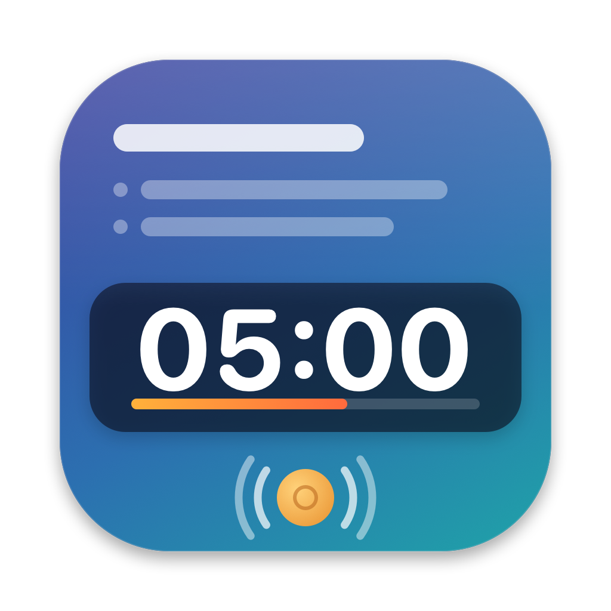

<p align="center">
  
</p>

# MacTimer

Ein Übungs-Timer für macOS, gedacht für Vorlesungen und Workshops: Während eine Präsentationsfolie gezeigt wird, liegt ein halbtransparenter Countdown-Banner über dem Bildschirm. Am Ende der Zeit ertönt ein Gong.

Der Banner liegt auch über PowerPoint-Präsentationen im Vollbildmodus und nimmt der Präsentation nicht den Fokus. Folienwechsel per Tastatur oder Presenter funktionieren also weiterhin.

Ist ein externer Bildschirm angeschlossen, wechselt der Banner automatisch dorthin. Das gilt auch, wenn PowerPoint beim Start der Präsentation die Bildschirmspiegelung aufhebt, um auf dem Laptop die Referentenansicht zu zeigen. Endet die Präsentation und die Spiegelung wird wiederhergestellt, bleibt der Banner sichtbar.

## Funktionen

- **Schnellstart über die Menüleiste:** Presets für 5, 10, 15, 20 und 30 Minuten oder eine eigene Dauer
- **Globales Tastenkürzel ⌃⌥T:** öffnet von überall ein Eingabefeld für die Dauer (`10`, `7,5` oder `7:30`); Enter startet, Esc bricht ab
- **Banner-Overlay:**
  - halbtransparent, liegt über allen Fenstern und auf allen Spaces
  - per Ziehen verschiebbar, über den Griff unten rechts skalierbar; die Schrift passt sich der Größe an
  - Position und Größe bleiben nach einem Neustart erhalten
- **Während der Übung:** Zeit um eine Minute verlängern oder verkürzen, Timer beenden (Buttons im Banner oder im Menü)
- **Farbhinweise:** In der letzten Minute werden die Ziffern orange, nach Ablauf erscheint „Zeit ist um“ in Rot
- **Gong:** spielt einmal am Ende; die Audiodatei ist austauschbar
- Läuft als reine Menüleisten-App ohne Dock-Symbol; im laufenden Betrieb zeigt die Menüleiste die Restzeit an

## Voraussetzungen

- macOS 14 (Sonoma) oder neuer
- Xcode bzw. die Xcode Command Line Tools mit Swift 6

## Bauen und starten

```sh
./scripts/build-app.sh
open build/MacTimer.app
```

Das Skript baut das Swift Package im Release-Modus, setzt daraus `build/MacTimer.app` zusammen und signiert die App ad hoc. Anschließend kann die App in den Ordner „Programme“ verschoben werden.

Das Projekt lässt sich auch in Xcode öffnen:

```sh
open Package.swift
```

### Hinweis zur Signatur

Die App wird ohne Entwickler-Zertifikat signiert. Auf dem Rechner, auf dem sie gebaut wurde, startet sie ohne Rückfrage. Auf einem anderen Mac blockiert Gatekeeper den ersten Start; dort die App einmal per Rechtsklick und „Öffnen“ starten.

## Bedienung

| Aktion | So geht's |
| --- | --- |
| Timer mit Preset starten | Menüleisten-Symbol → z. B. „10 Minuten“ |
| Eigene Dauer starten | ⌃⌥T oder Menü → „Eigene Dauer …“, Dauer eingeben, Enter |
| Banner verschieben | Banner mit der Maus ziehen |
| Banner skalieren | Griff unten rechts ziehen (erscheint beim Darüberfahren) |
| Zeit anpassen | Buttons `−1` / `+1` im Banner oder im Menü |
| Timer beenden | Button `✕` im Banner oder Menü → „Timer beenden“ |
| Banner wiederfinden | Menü → „Banner-Position zurücksetzen“ (z. B. nach Abstecken des Beamers) |

Nach Ablauf bleibt der Banner noch 5 Sekunden sichtbar und verschwindet dann von selbst. Ein Klick auf `+1` in dieser Zeit startet eine weitere Minute.

## Gong anpassen

Die App sucht den Gong in dieser Reihenfolge:

1. eine über das Menü „Gong-Datei wählen …“ ausgewählte Datei (wird gespeichert)
2. `Resources/gong.*` im Projekt (`.mp3`, `.wav`, `.m4a`, `.aiff` oder `.caf`), die beim Bauen in die App kopiert wird
3. der macOS-Systemsound „Glass“ als Rückfallebene

Über „Gong testen“ im Menü lässt sich der Klang jederzeit prüfen. Nach dem Austausch von `Resources/gong.*` muss die App neu gebaut werden.

## App-Icon

Das Icon wird per Skript gezeichnet:

```sh
swift scripts/make-icon.swift
```

Das erzeugt `Resources/AppIcon.icns` sowie eine Vorschau `Resources/AppIcon-preview.png`. Farben und Motiv lassen sich direkt im Skript anpassen.

## Tests

```sh
swift test
```

Die Tests (Swift Testing) decken die Timer-Logik ab: Formatierung der Restzeit, Auswertung der Eingabe, Verlängern und Verkürzen sowie das einmalige Auslösen am Ende.

## Projektstruktur

```
Package.swift                     Swift Package (macOS 14+, Swift 6)
Sources/MacTimer/
  MacTimerApp.swift               Einstieg, Menüleiste, Zusammenspiel der Komponenten
  TimerModel.swift                Countdown-Logik, Formatierung, Eingabe-Parser
  BannerPanel.swift               Overlay-Fenster, Verschieben und Skalieren
  BannerView.swift                Darstellung des Banners
  QuickStartPanel.swift           Eingabefenster für die Dauer
  HotKey.swift                    Globales Tastenkürzel (Carbon)
  GongPlayer.swift                Wiedergabe des Gongs
Tests/MacTimerTests/              Tests für TimerModel
Support/Info.plist                Bundle-Konfiguration (u. a. ohne Dock-Symbol)
Resources/                        Gong, App-Icon
scripts/build-app.sh              Baut build/MacTimer.app
scripts/make-icon.swift           Erzeugt das App-Icon
```

## Bekannte Einschränkungen

- Das Tastenkürzel ⌃⌥T ist fest eingestellt. Ist es bereits von einer anderen App belegt, lässt es sich nicht registrieren; die Änderung erfolgt in `Sources/MacTimer/MacTimerApp.swift`.
- Pausieren ist bewusst nicht vorgesehen.
